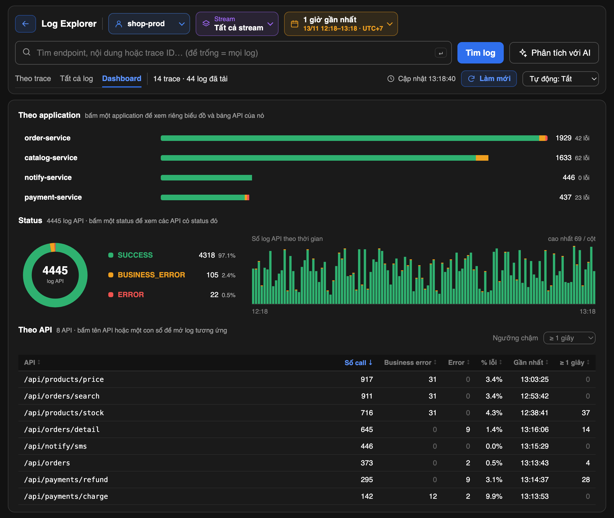
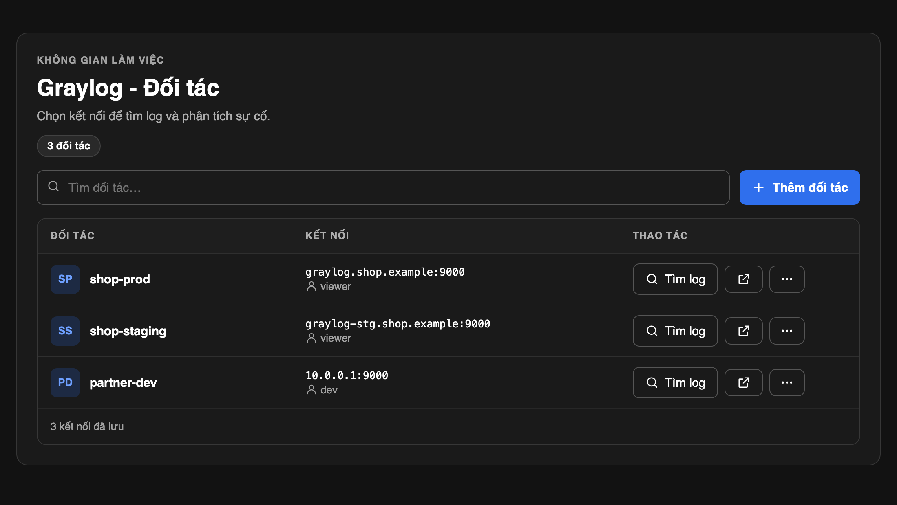
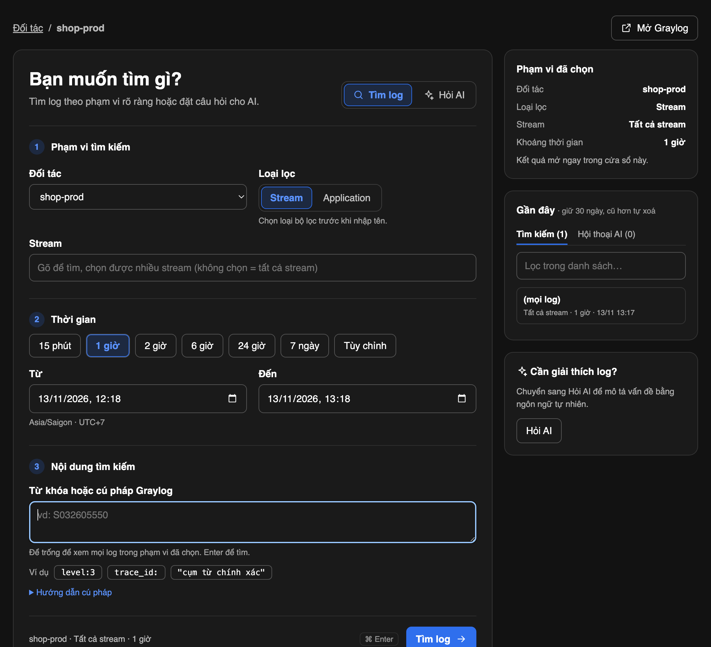
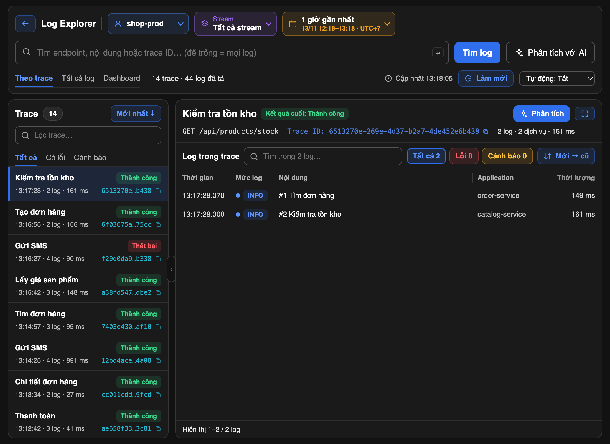

# Graylog app

Ứng dụng máy tính (macOS, Windows) để làm việc với Graylog của nhiều đối tác: lưu đăng nhập, tìm log theo trace, xem Dashboard theo API, và hỏi AI về sự cố.



## Tính năng

- **Nhiều đối tác**: mỗi đối tác một địa chỉ Graylog và tài khoản riêng; mật khẩu nằm trong Keychain (macOS) hoặc Credential Manager (Windows), không nằm trong file nào.
- **Tìm log theo trace**: gom các log cùng trace id thành một lượt gọi, thấy từng bước qua từng service, thời lượng và kết quả cuối.
- **Dashboard**: số call, lỗi nghiệp vụ, lỗi hệ thống, % lỗi, lần gọi gần nhất và số call chậm theo từng API; biểu đồ theo thời gian và theo application; sắp xếp nhiều cột; bấm một con số để mở đúng các log đó.
- **Phân tích với AI** (tuỳ chọn): đặt câu hỏi bằng tiếng Việt về một trace hoặc một sự cố.
- **Mở Graylog**: mở trang Graylog của đối tác và tự đăng nhập (macOS).

Hướng dẫn dùng từng màn hình: [docs/huong-dan.md](docs/huong-dan.md).

| Đối tác | Tìm log |
|---|---|
|  |  |



Ảnh chụp dùng dữ liệu giả (`docs/demo/gl.py`).

Danh sách đối tác nằm ở `~/.config/gl/` trên từng máy và không thuộc repo này — máy mới phải tự thêm đối tác và nhập mật khẩu.

## Cài (macOS và Windows)

Cần [uv](https://docs.astral.sh/uv/). Một lệnh:

```sh
uv tool install git+https://github.com/1551010058/graylog-app
```

Sau đó:

| | |
|---|---|
| `graylog-app` | mở app |
| `gl` | dòng lệnh |
| `uv tool upgrade graylog-app` | cập nhật bản mới (rồi chạy lại `graylog-app`) |
| `uv tool uninstall graylog-app` | gỡ |

- **macOS**: lần đầu `graylog-app` tự build `~/Applications/Graylog.app` (cần Xcode Command Line Tools: `xcode-select --install`), các lần sau mở app từ Dock như bình thường. Chưa có Command Line Tools thì tool mở bằng cửa sổ Chrome dạng app. App chạy code chép ở `~/.local/bin`.
- **Windows**: `graylog-app` mở một cửa sổ Edge/Chrome dạng app; đóng cửa sổ là tắt. Bản Windows chưa được chạy thử trên máy thật.

Không dùng uv: clone repo; macOS chép các file trong `graylog_app/` vào `~/.local/bin` rồi chạy `gl-app-build`, Windows bấm đúp `graylog_app\Graylog.cmd` (cần Python 3.9+).

## Khác nhau giữa hai hệ điều hành

- Tự điền đăng nhập vào Chrome chỉ có trên macOS. Trên Windows mật khẩu được copy vào clipboard và tự xoá sau 45 giây.
- macOS có menu và mở được nhiều cửa sổ.

## Phân tích với AI (tuỳ chọn)

Cần cài thêm [`claude`](https://claude.com/claude-code) và [`uv`](https://docs.astral.sh/uv/). Tính năng này gửi nội dung log lên Claude.

## Lưu ý bảo mật

- Nếu Graylog chạy `http://`, user và mật khẩu đi trên mạng không mã hoá. Nên dùng https hoặc VPN.
- Không commit `~/.config/gl/` (địa chỉ nội bộ, username, log).

## Giấy phép

[MIT](LICENSE)
