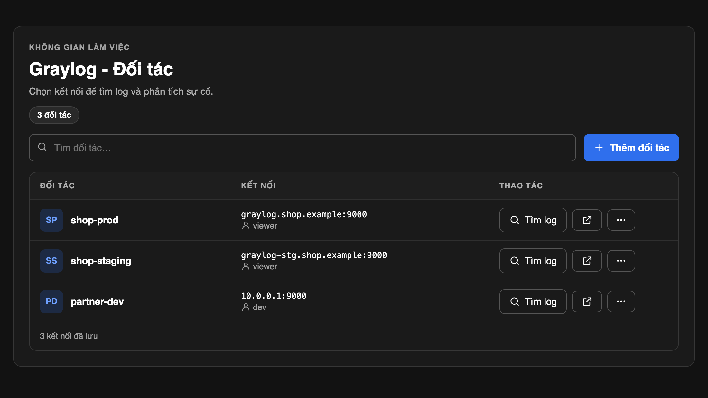
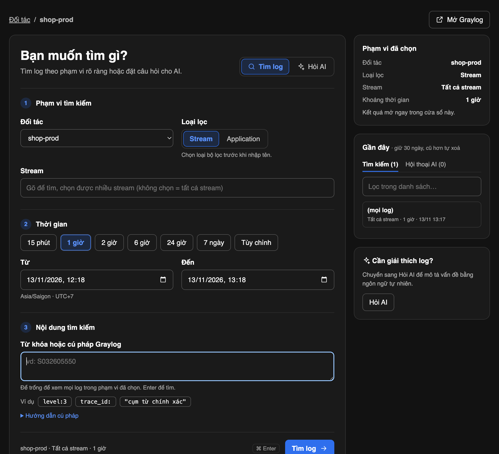
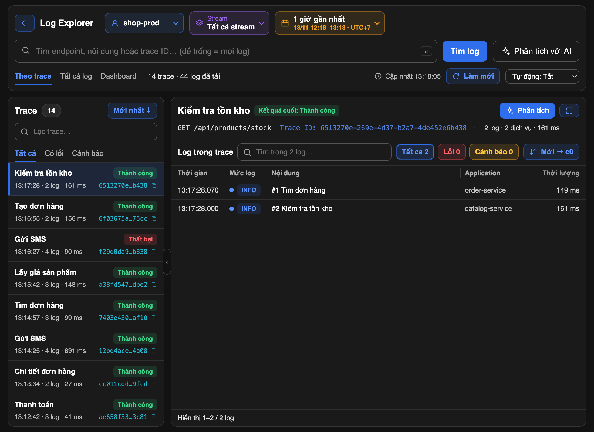
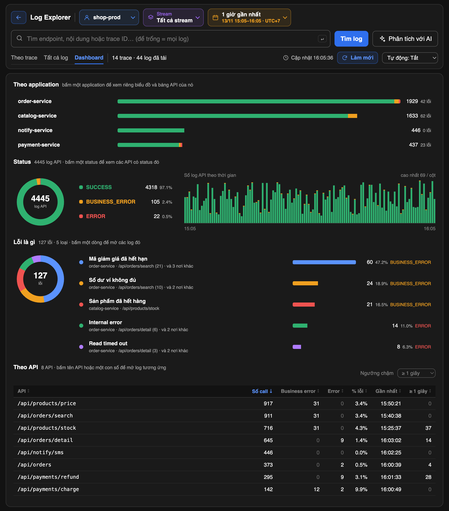

# Hướng dẫn sử dụng

## 1. Đối tác



- **Thêm đối tác**: nhập tên, địa chỉ Graylog (vd `http://10.0.0.1:9000`), tài khoản và mật khẩu. Có nút thử kết nối trước khi lưu.
- **Tìm log**: sang màn hình tìm kiếm của đối tác đó.
- Nút mũi tên: mở Graylog của đối tác trong Chrome. Trên macOS tool tự điền đăng nhập; trên Windows mật khẩu được copy vào clipboard và tự xoá sau 45 giây.
- Nút `…`: sửa hoặc xoá đối tác. Trong form sửa, biểu tượng con mắt hiện mật khẩu đã lưu.

## 2. Tìm log



1. **Phạm vi**: chọn một hay nhiều stream, hoặc lọc theo application. Không chọn nghĩa là tất cả stream.
2. **Thời gian**: 15 phút đến 7 ngày, hoặc tuỳ chỉnh từ – đến.
3. **Nội dung**: từ khoá, trace id, hoặc cú pháp Graylog (`field:giá_trị`, `AND` / `OR` viết hoa, cụm từ chính xác đặt trong ngoặc kép). Để trống là xem mọi log.

Dán thẳng link một log của Graylog (`http://10.0.0.1:9000/messages/<index>/<id>`) vào ô nội dung, hoặc vào ô "Tìm đối tác…" ở màn hình Đối tác rồi Enter, cũng được: tool mở toàn bộ trace của log đó trong khoảng 30 phút trước và sau, bỏ qua phạm vi và thời gian đang chọn. Link của đối tác khác cũng được: tool tự chuyển sang đối tác có cùng địa chỉ Graylog.

Cột bên phải giữ các lần tìm và các hội thoại AI gần đây trong 30 ngày.

## 3. Kết quả

Kết quả có ba tab.

### Theo trace



Mỗi dòng bên trái là một lượt gọi (một trace id) kèm kết quả cuối, số log và thời lượng. Chọn một trace để xem từng bước bên phải; bấm một bước để xem URL, header, request body và response. Lọc được theo "Có lỗi" / "Cảnh báo".

Tool nhận log API theo khuôn sau (các service ghi log khác khuôn vẫn hiện ở tab "Tất cả log"):

```
== INFO API ==
Trace ID: …
Step: …
URL: POST http://…
Description: …
Headers: …
Request Body: …
Duration: … ms
Status: SUCCESS | BUSINESS_ERROR | ERROR
Response: …
```

### Tất cả log

Mọi log theo thứ tự thời gian, kể cả log không thuộc trace nào.

### Dashboard



Số liệu do Graylog đếm trên toàn bộ phạm vi đang chọn, không phải chỉ trên các log đã tải.

- **Theo application**: hiện khi có từ hai application trở lên. Bấm một application để xem riêng biểu đồ và bảng API của nó.
- **Status**: bấm một status để chỉ xem các API có status đó.
- **Lỗi là gì**: biểu đồ tròn và danh sách 10 loại lỗi nhiều nhất, mỗi loại kèm application và API bị nhiều nhất (rê chuột vào dòng đó để xem 5 nơi bị nhiều nhất, kèm số lần và lần gần nhất). Lỗi được gộp theo câu báo lỗi trong response (`message`, `toastMessage` hoặc `errorReason`); lỗi không có response thì gộp theo tên exception. Bấm một dòng để mở các log đó. Phần này cần field `response_body` / `api_exception`, tức chỉ có với log theo khuôn `api_status`.
- **Theo API**: bấm tiêu đề cột để sắp xếp; bấm thêm cột khác để sắp xếp tiếp trên kết quả đang có (số nhỏ cạnh mũi tên là thứ tự bấm); "Bỏ sắp xếp" để về mặc định. Bấm tên API hoặc một con số để mở các log tương ứng, rồi "← Quay lại Dashboard" để về đúng trạng thái trước đó.
- **Ngưỡng chậm**: chọn sẵn từ 200 ms đến 10 giây, hoặc tự nhập số ms. Cột cuối đếm số call có `duration_ms` từ ngưỡng đó trở lên.

Dashboard đếm theo các field `api_status`, `url_path`, `application`, `duration_ms`. Nếu phạm vi đang xem không có log nào mang `api_status`, tool tự dò field khác đang có log để thay:

| Vai | Thứ tự dò |
|---|---|
| Status | `http_status`, `http_status_code`, `status_code`, `http_response_code`, `response_code`, `response_status`, `status`, `level` |
| API | `request_path`, `http_path`, `path`, `uri`, `request_uri`, `url`, `endpoint`, `logger_name`, `source` |
| Application | `app`, `service`, `service_name`, `app_name`, `container_name`, `facility`, `source` |
| Thời gian xử lý | `took_ms`, `elapsed_ms`, `response_time_ms`, `duration`, `response_time`, `request_time` |

Khi đó status được gộp về ba nhóm: mã HTTP 5xx (hoặc `level` 0–3) là Error, 4xx (hoặc `level` 4, tức cảnh báo) là Business error, còn lại là Success. Graylog chỉ có `level` và `source` thì Dashboard thành bảng đếm log theo mức độ và theo máy gửi log.

"Làm mới" tải lại số liệu; "Tự động" làm mới theo chu kỳ.

## 4. Phân tích với AI

Cần cài [`claude`](https://claude.com/claude-code) và [`uv`](https://docs.astral.sh/uv/). Bấm "Phân tích với AI" hoặc nút "Phân tích" trên một trace rồi đặt câu hỏi. Nội dung log được gửi lên Claude; số điện thoại, CCCD và các dữ liệu tương tự được che trước khi gửi.

Khi hỏi tiếp trong hội thoại, có thể đính kèm hình hoặc file: bấm 📎, dán hình (Cmd/Ctrl+V) hoặc kéo thả vào ô nhập. Tối đa 5 file mỗi câu, mỗi file 10 MB. File đính kèm được gửi nguyên vẹn lên Claude, không che dữ liệu, và được lưu trong `~/.config/gl/ask/att/` cho tới khi hội thoại hết hạn 30 ngày.

## 5. Bảo mật

- Mật khẩu chỉ nằm trong Keychain / Credential Manager.
- Giao diện là một server chỉ nghe trên `127.0.0.1`, cổng ngẫu nhiên, đường dẫn có mã ngẫu nhiên đổi mỗi lần mở.
- Nếu Graylog chạy `http://`, tài khoản và mật khẩu đi trên mạng không mã hoá — nên dùng https hoặc VPN.
- `~/.config/gl/` chứa địa chỉ nội bộ, lịch sử tìm kiếm và hội thoại AI; không chia sẻ thư mục này.
